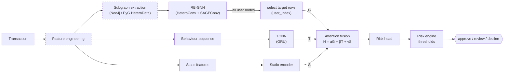

# Hybrid Fraud Intelligence

**A relational-temporal graph neural network (RB-GNN + TGNN + attention fusion) for real-time fraud detection.**

[](https://github.com/Kingpin139/hybrid-fraud-intelligence/actions/workflows/ci.yml)
[](https://www.python.org/downloads/)
[](https://pytorch.org/)
[](https://pyg.org/)
[](LICENSE)

Tabular models and pure GNNs miss coordinated, evolving fraud. This project combines three signals
in a single differentiable model:

```
H = αG + βT + γS
```

| Symbol | Meaning | Produced by |
|--------|---------|-------------|
| **G** | Graph embedding of the user (shared devices, IPs, cards, merchants, phones, e-mails) | `RBGNN` – heterogeneous GraphSAGE |
| **T** | Temporal embedding of recent behaviour (velocity, bursts, drift) | `TGNN` – GRU sequence encoder |
| **S** | Static feature embedding | MLP static encoder |
| **α, β, γ** | Fusion coefficients (non-negative, sum to 1) | `AttentionFusion` – softmax over learnable logits (+ optional per-sample attention) |

> **Project status: alpha (v0.1.0).** The model code, config, Neo4j schema, Docker setup and tests are in
> place. **Training scripts, dataset loaders, Neo4j subgraph extraction and LLM explanations are not
> implemented yet** (see the [roadmap](#roadmap)). The `/score` API endpoint currently returns a
> clearly-labelled *placeholder* heuristic (`"mode": "placeholder"`), not model output.

## Architecture



Dashed boxes are planned components (not yet implemented); the models, fusion, risk engine and API are implemented.

### Components

- **RB-GNN** (`hybrid_fraud.models.RBGNN`) – one `SAGEConv` per edge type inside a `HeteroConv`.
  - Nodes: `user`, `card`, `device`, `ip`, `merchant`, `phone`, `email`.
  - Edges: `transacts`, `uses`, `from`, `owns`, `shares` plus a reverse (`rev_*`) relation for each,
    including `rev_shares` for phones and e-mails, so shared identifiers flow back to users.
  - Per-node-type input projections (feature sizes may differ) and per-node-type `LayerNorm`s.
  - Only edge types present in the input `HeteroData` are used; node types that receive no messages keep
    their previous embedding (residual connection).
- **TGNN** (`TGNN`) – GRU over a `[batch, seq_len, features]` sequence; can be replaced with TGAT/TGN/DySAT.
- **Attention fusion** (`AttentionFusion`) – the learnable parameters are **logits**; coefficients are
  `softmax(logits)`. They are initialised with `log(prior)`, so training starts exactly at the configured
  `0.40 / 0.35 / 0.25`. With `use_dynamic_attention=True`, an MLP adds per-sample logits (zero-initialised,
  so it starts at the prior). The returned `weights` dict is the batch mean.
- **Hybrid model** (`HybridFraudModel`) – G comes from *all* user nodes in the graph, while T and S are
  per scored entity. Pass `user_index` (indices of the target users in `graph['user']`) to select the
  matching rows of G; without it the graph must contain exactly `batch` users, otherwise a clear
  `ValueError` is raised.
- **Risk engine** – maps a risk score to `approve` (< 0.30), `review` (< 0.65) or `decline`, configurable in
  `config/config.yaml`.
- **Neo4j schema** (`neo4j/schema.cypher`) – constraints, indexes and a sample fraud-ring query.

## Installation

Requires Python 3.10+.

```bash
git clone https://github.com/Kingpin139/hybrid-fraud-intelligence.git
cd hybrid-fraud-intelligence

python -m venv .venv && source .venv/bin/activate

# CPU-only PyTorch (skip --index-url if you want the default build / a GPU build)
pip install torch --index-url https://download.pytorch.org/whl/cpu

pip install -e ".[dev]"
```

## Usage

### Python

```python
import torch
from torch_geometric.data import HeteroData
from hybrid_fraud.models import HybridFraudModel

graph = HeteroData()
graph["user"].x = torch.randn(6, 32)
graph["merchant"].x = torch.randn(3, 32)
graph["user", "transacts", "merchant"].edge_index = torch.tensor([[0, 1, 2, 5], [0, 1, 2, 0]])
graph["merchant", "rev_transacts", "user"].edge_index = torch.tensor([[0, 1, 2, 0], [0, 1, 2, 5]])

model = HybridFraudModel(static_dim=32, hidden_channels=64).eval()

user_index = torch.tensor([5, 0, 2])        # score users 5, 0 and 2 of the graph
temporal = torch.randn(3, 8, 64)            # [batch, seq_len, hidden_channels]
static = torch.randn(3, 32)                 # [batch, static_dim]

with torch.no_grad():
    logits, weights = model(graph, temporal, static, user_index=user_index)
risk = logits.softmax(-1)[:, 1]             # untrained model: meaningless numbers
```

A runnable version is in [`examples/inference_demo.py`](examples/inference_demo.py):

```bash
python examples/inference_demo.py
```

Build a model from the YAML config with `HybridFraudModel.from_config(load_config())`.

### API

```bash
uvicorn hybrid_fraud.api.main:app --reload     # run from the repository root
```

```bash
curl -X POST http://localhost:8000/score \
  -H "Content-Type: application/json" \
  -d '{
    "transaction_id": "tx_001",
    "user_id": "user_123",
    "amount": 149.99,
    "merchant_id": "merch_456",
    "device_id": "dev_789",
    "timestamp": "2026-11-27T00:00:00Z"
  }'
```

Endpoints: `GET /health`, `POST /score`, `POST /batch_score` (max 1000 per call). Interactive docs at
`/docs`. Responses carry `"mode": "placeholder"` until the trained model is wired in.

### Docker (API + Neo4j)

```bash
cp .env.example .env        # set NEO4J_PASSWORD (>= 8 characters)
docker compose up --build
```

This starts Neo4j (browser on `:7474`, Bolt on `:7687`) and the API on `:8000`. Load the schema with:

```bash
docker compose exec neo4j sh -c 'cypher-shell -u neo4j -p "${NEO4J_AUTH#neo4j/}" -f /schema/schema.cypher'
```

### Configuration

`config/config.yaml` holds model, fusion prior, risk thresholds, Neo4j, API and (reserved) training
settings. Set `HFI_CONFIG` to use another file; `NEO4J_URI`, `NEO4J_USER`, `NEO4J_PASSWORD` and
`NEO4J_DATABASE` override the `neo4j` section. See [`.env.example`](.env.example).

## Project structure

```
hybrid-fraud-intelligence/
├── src/hybrid_fraud/
│   ├── models/          # RBGNN, TGNN, AttentionFusion, HybridFraudModel
│   ├── scoring/         # Risk engine (score -> decision)
│   ├── api/             # FastAPI service
│   └── config.py        # YAML + environment configuration
├── config/              # config.yaml
├── neo4j/               # Cypher schema and sample query
├── examples/            # Runnable inference demo
├── tests/               # pytest suite
├── docs/                # Architecture notes
├── .github/             # CI workflow, issue and PR templates
├── Dockerfile
├── docker-compose.yml
└── pyproject.toml
```

## Testing

```bash
pytest                        # unit + API tests
ruff check . && ruff format --check .
```

CI runs ruff and pytest on Python 3.10 and 3.11 with CPU-only PyTorch.

## Expected performance (hypothetical targets – not measured)

> ⚠️ **These numbers are design targets / hypotheses, not results.** No benchmark has been run in this
> repository yet: there is no trained model, dataset loader or evaluation script. Do not cite them as
> measured performance. They will be replaced by reproducible results (with dataset, split and seeds)
> once the evaluation pipeline exists.

| Model                    | Target AUC (hypothetical) |
|--------------------------|---------------------------|
| Logistic Regression      | 0.81                      |
| XGBoost                  | 0.89                      |
| Pure GNN                 | 0.93                      |
| **Hybrid RB-GNN + TGNN** | **0.97+**                 |

## Roadmap

- [ ] Dataset loaders (IEEE-CIS, PaySim, Elliptic, Amazon review fraud) and `HeteroData` graph builders
- [ ] Training / evaluation scripts (focal loss, class-imbalance handling) and measured benchmarks
- [ ] Neo4j client: k-hop subgraph extraction within the latency budget (`neo4j.subgraph_timeout_ms`)
- [ ] Wire trained weights into the API (replace the placeholder heuristic)
- [ ] Temporal GNN variants (TGAT, TGN, DySAT)
- [ ] Explainability: path tracing, fusion-weight reporting, optional LLM narratives
- [ ] Streaming ingestion (e.g. Kafka) and online updates for concept drift

## Contributing

See [CONTRIBUTING.md](CONTRIBUTING.md). Bug reports and ideas are welcome via issues.

## Citation

```bibtex
@software{hybrid_fraud_intelligence,
  title  = {Hybrid Fraud Intelligence: RB-GNN + TGNN Architecture},
  author = {Mahtab, Tanvir and {Hybrid Theory Research}},
  year   = {2026},
  url    = {https://github.com/Kingpin139/hybrid-fraud-intelligence}
}
```

## License

[MIT](LICENSE)
